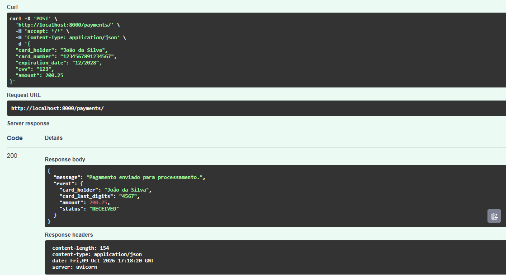
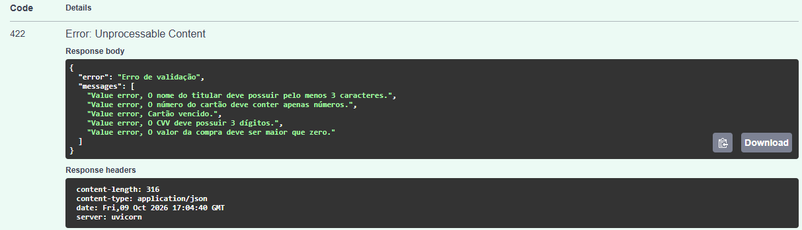
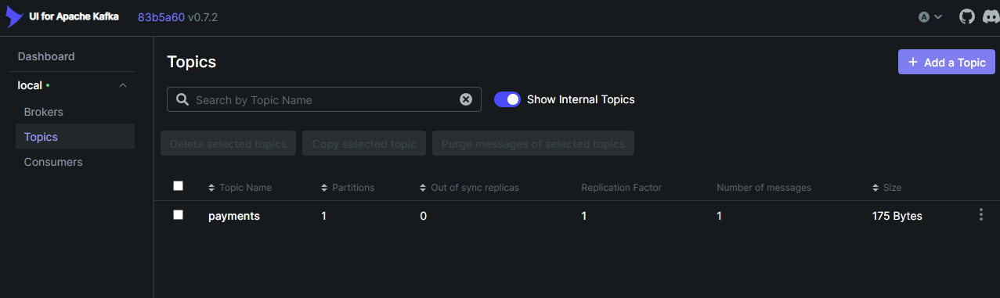
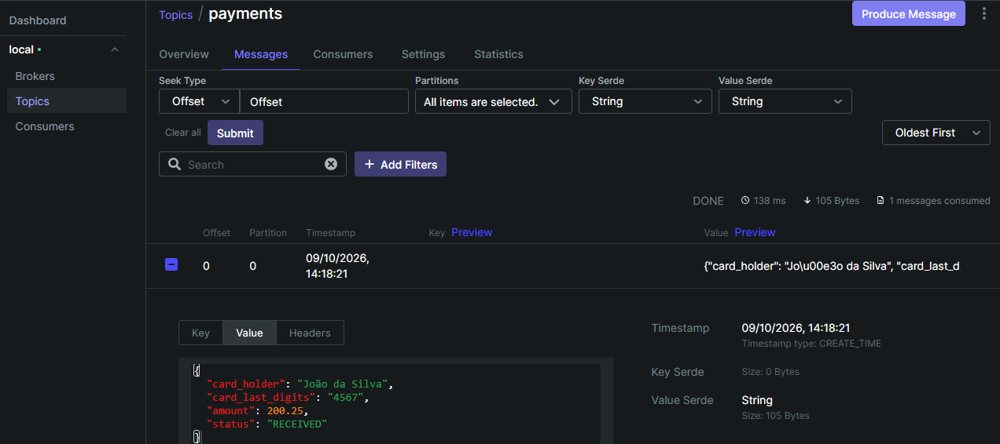

# Sistema de Pagamentos com Mensageria Kafka

Projeto desenvolvido com FastAPI, Kafka, ZooKeeper e Kafka UI para simulação de processamento de pagamentos utilizando arquitetura orientada a eventos.

## Tecnologias Utilizadas

- Python 3.14
- FastAPI
- Poetry
- Apache Kafka
- ZooKeeper
- Kafka UI
- Podman
- Podman Compose

## Arquitetura

```text
Cliente --> FastAPI --> Kafka Producer --> Topic payments --> Kafka UI
```

## Estrutura do Projeto


```text
pagamentos-kafka/
│
├── app/
│   ├── routes/
│   │   └── payments.py
│   │
│   ├── config.py
│   ├── exceptions.py
│   ├── main.py
│   ├── producer.py
│   └── schemas.py
│
├── public/
│   ├── 200post.png
│   ├── 422post.png
│   ├── inicial_topic.png
│   └── mensagem_pagamento.png
│
├── .dockerignore
├── .gitignore
├── docker-compose.yml
├── Dockerfile
├── poetry.lock
├── pyproject.toml
└── README.md
```

## Instalação

Certifique-se de possuir instalado:

- Python 3.14 ou superior
- Poetry
- Docker ou Podman
- Docker Compose ou Podman Compose

### Clonando o projeto

```bash
git clone https://github.com/tayanibritto/pagamentos-kafka.git
```

```bash
cd pagamentos-kafka
```

## Criação de variáveis de ambiente

Crie o arquivo .env na raiz do projeto:

```text
API_TITLE=Payments API

API_VERSION=1.0.0

KAFKA_TOPIC=payments

KAFKA_BOOTSTRAP_SERVERS=kafka:9092
```

## Executando o projeto

### Iniciar a máquina virtual

Caso você esteja usando o Podman, é necessário iniciar a máquina virtual:

```bash
podman machine start
```

Usuários de Docker podem pular esta etapa e ir para a próxima.

### Subir os containers

Usuários de Podman:

```bash
podman-compose up --build -d
```

Usuários de Docker:

```bash
docker-compose up --build -d
```

### Serviços

FastAPI:

```text
http://localhost:8000
```

Documentação Swagger:

```text
http://localhost:8000/docs
```

Kafka UI:

```text
http://localhost:8080
```

## Exemplo de Requisição

```json
{
  "card_holder": "João da Silva",
  "card_number": "1234567891234567",
  "expiration_date": "12/2028",
  "cvv": "123",
  "amount": 200.25
}
```

## Evento Publicado no Kafka

```json
{
  "card_holder": "João da Silva",
  "card_last_digits": "4567",
  "amount": 200.25,
  "status": "RECEIVED"
}
```

O evento publicado no Kafka contém apenas as informações necessárias para os consumidores do tópico `payments`.

Dados sensíveis informados na API, como número completo do cartão, data de expiração e CVV, não são enviados para o Kafka. Apenas os quatro últimos dígitos do cartão são publicados, reduzindo a exposição de informações sensíveis e seguindo as boas práticas de segurança.

## Evidência

Requisição 200:



Erro 422: Campos inválidos. Não registra no Kafka; evita poluição e retrabalho.



O tópico `payments` pode ser visualizado no Kafka UI e contém os eventos produzidos pela API FastAPI após o processamento das requisições de pagamento.





## Observação

O projeto foi desenvolvido e validado utilizando Podman e Podman Compose no Windows 11. Embora o docker-compose seja compatível com a configuração utilizada, a execução oficial deste projeto foi realizada com Podman.


